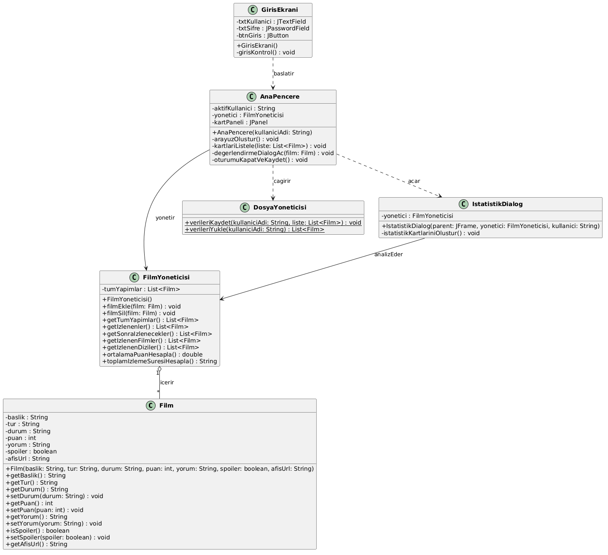

# 🎬 Kişisel Film ve Dizi Takip Sistemi (NYP1 Projesi)

Bu proje, **Nesneye Yönelik Programlama I (NYP1)** dersi kapsamında Java Swing kullanılarak geliştirilmiş kapsamlı bir masaüstü film ve dizi arşiv/takip uygulamasıdır. Kullanıcıların izledikleri ve izlemek istedikleri yapımları yönetmelerini, özel yıldız puanlama sistemiyle değerlendirmelerini ve izleme istatistiklerini görüntülemelerini sağlar.

---

## 📌 Temel Özellikler

* **Keşfet & Katalog Vitrini:** Popüler film ve dizilerin listelendiği dinamik ana sayfa.
* **Kişisel Listeler:** Tek tıkla "İzlediklerim" veya "Sonra İzlenecekler" listelerine ekleme.
* **İnteraktif Yıldız Puanlama:** Yapımlara 1-5 arası yıldız puanı verme, yorum ekleme ve spoiler (sürprizbozan) koruması.
* **Kullanıcı Bazlı Veri Kalıcılığı:** Çıkış yapıldığında verilerin yerel dosyaya otomatik kaydedilmesi ve tekrar girişte geri yüklenmesi.
* **Profil & İstatistikler:** Toplam izleme süresi, ortalama puan ve izlenen yapım sayılarını hesaplayan analiz paneli.
* **Gelişmiş Arayüz (GUI):** Sekmeli filtreleme menüleri ve boş liste (empty-state) durum bildirimleri.

---

## 🏗️ Mimari ve OOP Prensipleri

Proje, katmanlı ve modüler bir mimari ile geliştirilmiştir:

* **Model Katmanı (`Film.java`):** Veri alanları `private` olarak kapsüllenmiş (Encapsulation) olup geçerlilik kontrolleri içeren `getter/setter` metotlarına sahiptir.
* **İş Mantığı Katmanı (`FilmYoneticisi.java`):** Koleksiyon yönetimi, filtreleme ve istatistik hesaplama algoritmalarını yürütür.
* **Veri Kalıcılığı (`DosyaYoneticisi.java`):** Oturum verilerinin dosya giriş/çıkış (I/O) ve hata yönetimini (Exception Handling) üstlenir.
* **Arayüz Katmanı (`GirisEkrani.java`, `AnaPencere.java`, `IstatistikDialog.java`):** Java Swing tabanlı modern kullanıcı etkileşimi ve olay dinleyicileri (Event Handling).

---

## 📊 UML Sınıf Diyagramı

Projenin sınıf mimarisini ve ilişkilerini gösteren şema repoda yer alan `UML_Sinif_Diyagrami.png` dosyasında belgelenmiştir.

---

## 🚀 Kurulum ve Çalıştırma

Projeyi çalıştırmak için sisteminizde **Java JDK 8 veya üzeri** bir sürümün yüklü olması yeterlidir:

1. Depoyu klonlayın veya ZIP olarak indirin.
2. Ana dizindeki **`Derle_ve_Calistir.bat`** dosyasını çift tıklayarak çalıştırın.
